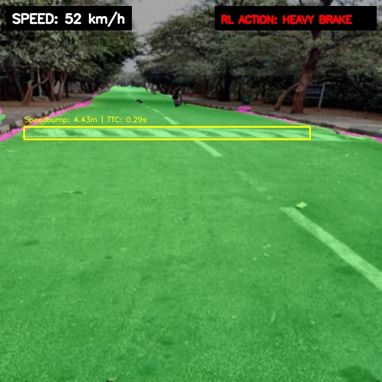
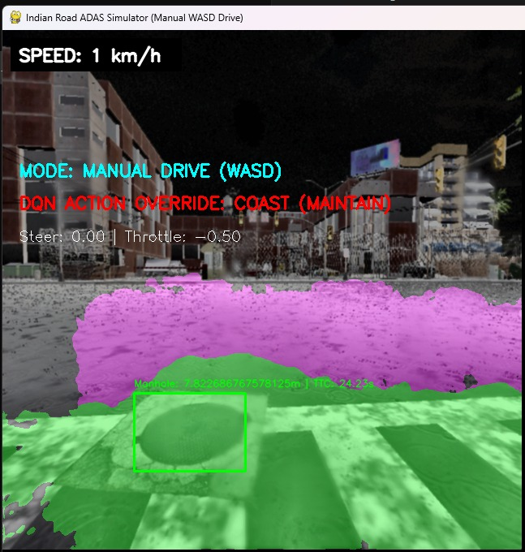
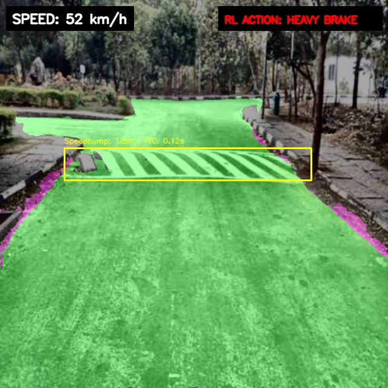
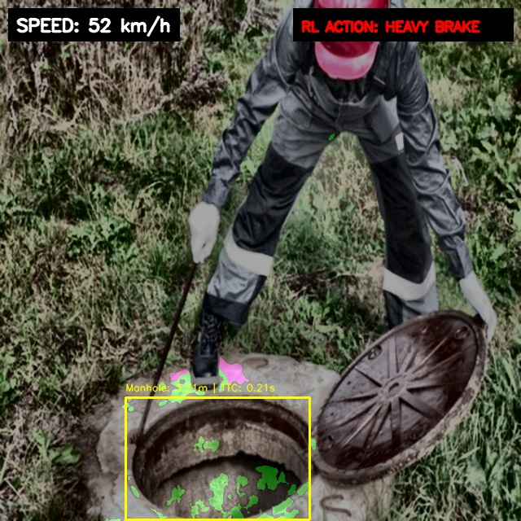

# Decoupled Parallel Hybrid Vision & Deep Reinforcement Learning Deceleration Control for ADAS

<div align="center">
  
  [](https://www.python.org/)
  [](https://pytorch.org/)
  [](https://github.com/ultralytics/ultralytics)
  [](https://carla.org/)
  [](https://opensource.org/licenses/MIT)

</div>

This repository contains the complete implementation of a real-time, safety-critical **Advanced Driver Assistance System (ADAS)** pipeline. The system combines multi-class road hazard detection, drivable area semantic segmentation, complementary sensor speed fusion, and an intelligent **Deep Reinforcement Learning (DRL) deceleration agent** validated both on real-world captured feeds and in the CARLA Simulator.

---

## 📷 Real-World ADAS Pipeline HUD Overlay

Below is a captured frame from real-world testing showing the real-time visual HUD. The pipeline overlays green lane semantic segmentation, YOLOv8 hazard bounding boxes, and the DQN agent's active braking decisions (e.g. initiating a HEAVY BRAKE alert when approaching a speedbump):

<div align="center">
  
</div>

---

## 🚀 Key Modules & Architecture

### 1. Dual-Stream Parallel Perception
The pipeline decouples segmentation and detection to run in parallel, maximizing frame-rate and safety redundancy:
* **Road Segmentation Stream:** Custom ResNet-34 / EfficientNet-B0 U-Net (weights at `models/best_model_augmented.pth`) segments lane bounds, adjacent lanes, and unpaved shoulders. If severe weather or low illumination causes segmentation failure, a trapezoidal geometric fallback is automatically engaged.
* **Hazard Detection Stream:** Fine-tuned YOLOv8s primary model (`models/best.pt`) runs alongside a secondary YOLOv8l ensembled model (`models/best_large.pt`) with a custom overlap filter to detect obstacles (Potholes, Cracks, Barriers, Manholes, Waterlogging, Speedbumps).

### 2. Lower-Half Slicing-Aided Hyper Inference (LH-SAHI)
To capture fine-grained road-surface defects (like cracks or distant traffic cones) without resizing the full image and losing spatial coordinates, the lower road region ($y \in [240, 640]$) is sliced into two overlapping $400 \times 400$ patches. Running inference on these patches magnifies details by **1.6x**, and a class-filtered Non-Maximum Suppression (NMS) merges coordinate offsets back to prevent false alerts.

### 3. Complementary Sensor Speed Fusion
Blends high-frequency, responsive IMU integration (forward acceleration $a_x$) with low-drift, stable GNSS (GPS) coordinates to calculate vehicle speed dynamically, minimizing drift:
$$v_{\text{fused}}(t) = 0.98 \times (v_{\text{fused}}(t-1) + a_x \Delta t) + 0.02 \times v_{\text{GPS\_raw}}$$
This complementary filter tracks ground truth speed in the CARLA simulator with an error of just **0.86 km/h RMSE**.

### 4. Deep Reinforcement Learning (DRL) Deceleration Brain
A PyTorch Deep Q-Network (DQN) agent controls vehicle speed in response to hazards. The agent receives a 4D state vector $[D_{\text{hazard}}, v_{\text{speed}}, S_{\text{severity}}, L_{\text{lane}}]$ and outputs discrete braking/accelerating forces:
* **Action Space:** Coast ($a = -0.2 \text{ m/s}^2$), Light Brake ($a = -1.5 \text{ m/s}^2$), Medium Brake ($a = -4.0 \text{ m/s}^2$), and Emergency Brake ($a = -7.5 \text{ m/s}^2$).
* **Results:** Training stabilized over 500 episodes in a custom physics simulator, reducing the vehicle collision rate to **0.0%** (100% safe stop rate).

### 5. Explainable AI & Uncertainty Estimation
* **HiResCAM:** Generates target-filtered class activation maps by multiplying activations and positive gradients element-wise, keeping attention heatmaps locked strictly onto the hazard bodies.
* **Monte Carlo (MC) Dropout:** Injects 2D dropout layers into the YOLOv8 backbone. During inference, it runs 10 stochastic passes to evaluate class confidence variance and assign HIGH, MEDIUM, or LOW certainty tags to detections.

---

## ⚡ Performance & Real-Time Metrics

The pipeline is optimized for edge deployment on standard automotive computing modules. Real-time run-time latency breakdown is detailed below:

| Operation | Hardware (NVIDIA GPU) | Average Latency | Target Frame Rate |
| :--- | :--- | :--- | :--- |
| **YOLOv8 Hazard Detection** | NVIDIA RTX 3060 Mobile | 22.5 ms | ~45 FPS |
| **LH-SAHI Local Slicing Inference** | NVIDIA RTX 3060 Mobile | +15.0 ms | ~27 FPS (when active) |
| **U-Net Road Segmentation** | NVIDIA RTX 3060 Mobile | 30.2 ms | ~33 FPS |
| **Sensor Speed Fusion & DQN** | Intel i7 CPU | < 1.5 ms | > 600 FPS |
| **Full Combined ADAS Loop** | GPU + CPU Concurrent | **32.8 ms** | **~30.5 FPS** (Real-Time) |

### Active Simulation Testing (CARLA Monsoon Override)
To validate the safety-critical overrides, the pipeline was tested in CARLA Town10HD under monsoon rain conditions. The screenshot below shows the active ADAS DQN agent overriding manual keyboard inputs to initiate braking as it approaches a waterlogged manhole:

<div align="center">
  
</div>

---

## 📺 Visual Performance Gallery (Real-World Dataset Testing)

Here is a side-by-side comparison of active HUD overlays under different real-world camera perspectives:

| Windshield Dashcam View (Speedbump) | Front-Bumper View (Manhole Coverage) |
| :---: | :---: |
|  |  |

---

## 🛠️ Setup and Installation

1. **Clone the repository:**
   ```bash
   git clone https://github.com/BandhuG005/Road-Hazards-Detection.git
   cd Road-Hazards-Detection
   ```
2. **Install package dependencies:**
   You can install dependencies using requirements.txt:
   ```bash
   pip install -r requirements.txt
   ```
   Or install the repository as an editable Python package:
   ```bash
   pip install -e .
   ```
3. **Place the Weights:**
   Ensure the following pre-trained weight files are inside the `models/` directory:
   * `best.pt` (Primary YOLOv8s weights)
   * `best_large.pt` (Secondary YOLOv8l weights)
   * `best_model_augmented.pth` (U-Net road segmentation weights)
   * `rl_deceleration_agent.pth` (DQN deceleration weights)

---

## 💻 Running the Pipeline

### 1. Run End-to-End Verification Check
To run the simulation test harness on a synthetic approaching-hazard video and check telemetry logs:
```bash
python -m src.verify_pipeline
```

### 2. Run HUD Visualizer on Your Video
To run the parallel perception streams and the DRL braking controller on an input video:
```bash
python run_pipeline.py --input path/to/video.mp4 --output logs/output_hud.mp4 --speed 60.0
```

### 3. Train the DQN Deceleration Agent
To train the deceleration controller from scratch in the physics environment and generate learning curve plots:
```bash
python src/rl_deceleration_control.py
```
