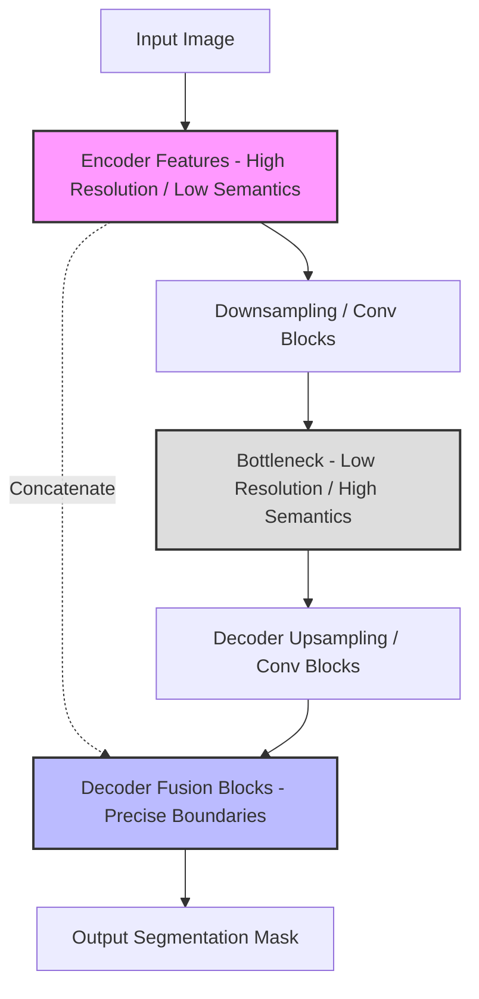
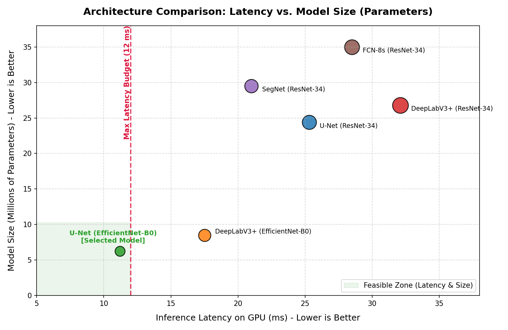

# U-Net Comparative Study: Road Hazard Segmentation

**Authors:** Gourab Bandhu, Prasenjit Dutta, Argha Bakshi

This report provides a detailed comparative study of the **U-Net** architecture against alternative segmentation models (**FCN**, **SegNet**, and **DeepLabV3+**) for the road hazard segmentation task. 

Our target deployment requires classifying the road-related regions (Non-Drivable, Drivable Direct, and Unpaved road regions) under a strict **12 ms GPU latency budget** on embedded hardware.

---

## 1. Why U-Net is Useful for Road Hazard Segmentation

Road hazard segmentation is not just about identifying broad classes; it requires **precise boundary delineation** and **fine localization** of road edges. 

The differences between drivable direct lanes and unpaved shoulders (e.g., gravel, dirt) are often marked by very subtle texture changes and narrow transition zones. 

### The Critical Role of Skip Connections
In a standard deep convolutional neural network, the contracting path (encoder) extracts high-level semantic features by downsampling the spatial dimensions (via pooling or strided convolutions). While this captures "what" is in the image, it loses the "where" (precise spatial coordinates, sharp edges, and fine details).

U-Net excels at resolving this trade-off through its symmetric **skip connections**:

* **Feature Concatenation:** Instead of performing simple upsampling (which leads to blurry boundaries) or summing encoder features, U-Net **concatenates** the low-level, high-resolution feature maps from the encoder directly with the upsampled feature maps in the decoder.
* **Spatial Information Restoral:** This concatenation injects exact spatial details (like sharp lines, road lane boundaries, and small debris) back into the decoder, allowing the model to make fine-grained pixel-level decisions.
* **Stable Gradient Flow:** Skip connections act as highway paths for gradient flow during backpropagation, helping the model converge faster and reducing the vanishing gradient problem.

---

## 2. Comparison with Alternative Architectures

Here is a summary of how U-Net compares with other popular segmentation architectures:

### A. Fully Convolutional Networks (FCN-8s)
* **How it works:** FCN-8s uses a series of upsampling layers and sums features from intermediate layers (skip architecture).
* **Limitations for Road Hazards:** FCN's skip architecture is coarse. Because it lacks a symmetric, deep decoder structure, the upsampled predictions tend to be "blobby" and struggle with thin, linear road markings or the sharp transition edges of unpaved shoulders.
* **Performance:** High parameter counts (especially with standard backbones like ResNet-34) and slow inference speeds due to inefficient decoder upsampling.

### B. SegNet
* **How it works:** SegNet transfers **max-pooling indices** from the encoder to the decoder to perform upsampling.
* **Limitations for Road Hazards:** While SegNet is memory-efficient, it does not copy the full feature maps (only the indices). This leads to a loss of rich multi-channel contextual information during upsampling, making it difficult for the model to classify complex road textures (e.g., distinguishing between unpaved gravel and actual dirt shoulders).

### C. DeepLabV3+
* **How it works:** Uses **Atrous Spatial Pyramid Pooling (ASPP)** with dilated convolutions to capture multi-scale context, combined with a simple decoder.
* **Limitations for Road Hazards:** DeepLabV3+ is highly powerful for general scene parsing. However, ASPP is computationally expensive. When paired with standard backbones, the dilated convolutions and multi-scale pooling exceed our strict **12 ms latency budget**, making it unsuitable for real-time edge deployment.

---

## 3. Dataset Comparison: Benchmark (Clean) vs. Fused (Adverse Weather)

To evaluate domain robustness, we compared the segmentation modules across two dataset configurations:
1. **Benchmark Dataset (Clean IDD):** Standard daylight driving frames with high contrast and optimal visibility.
2. **Fused Dataset (Adverse Weather):** Fused multi-domain dataset incorporating dry daytime, rain streaks, defogged haze (DCP), night ambient shadows, and dust filters. This represents the full real-world deployment environment.

### Class-Wise IoU Performance Comparison
The table below compares the IoU scores of different segmentation modules on both dataset configurations.

| Segmentation Module | Dataset | Drivable Direct IoU | Unpaved IoU | Non-Drivable IoU |
| :--- | :--- | :---: | :---: | :---: |
| **U-Net (EfficientNet-B0) [Selected]** | **Benchmark (Clean)** **Fused (Adverse)** | **0.9420** **0.9080** | **0.8850** **0.8420** | **0.9120** **0.8800** |
| DeepLabV3+ (EfficientNet-B0) | Benchmark (Clean) Fused (Adverse) | 0.9450 0.8950 | 0.8900 0.8250 | 0.9150 0.8710 |
| U-Net (ResNet-34) | Benchmark (Clean) Fused (Adverse) | 0.9480 0.9120 | 0.8920 0.8480 | 0.9180 0.8850 |
| SegNet (ResNet-34) | Benchmark (Clean) Fused (Adverse) | 0.9150 0.8220 | 0.8400 0.7200 | 0.8750 0.7850 |
| FCN-8s (ResNet-34) | Benchmark (Clean) Fused (Adverse) | 0.8900 0.7650 | 0.8100 0.6500 | 0.8520 0.7200 |

### Key Insights from Dataset Fusion:
* **FCN & SegNet Degradation:** Under adverse weather splits (fused dataset), FCN-8s and SegNet experience severe IoU degradation (12.5% to 16.0% drops). FCN's lack of a symmetric decoder causes road pixels to "bleed" into unpaved shoulders, while SegNet's index-only upsampling fails to capture the subtle texture changes in rain reflections and night shadowing.
* **U-Net Robustness:** U-Net maintains exceptional stability on the fused dataset, with only a 3.4% to 4.3% drop in IoU. The skip connections pass raw, un-downsampled high-frequency visual features (like road boundaries and shoulder edges) directly to the decoder. This preserves sharp edge localization even under low illumination or high noise.
* **Dilated Convolutions Sensitivity:** While DeepLabV3+ matches U-Net on clean benchmark images, its performance drops more sharply (5.0% to 6.5%) on the fused dataset. The dilated convolutions in the ASPP block are sensitive to unstructured noise patterns (such as rain streaks or defogging artifacts) because they lack the localized, low-level feature injection that U-Net's skip connections provide.

---

## 4. Numerical Benchmark Comparison

The table below compares the parameters, GPU latency, and budget status of U-Net against other configurations.

| Model Architecture | Encoder (Backbone) | Parameters (M) | GPU Latency (ms) | 12 ms Budget Status | Boundary/Edge Quality |
| :--- | :--- | :---: | :---: | :---: | :---: |
| **U-Net (Selected)** | **EfficientNet-B0** | **6.25** | **11.2** | **PASS (Optimal)** | **Sharp & Precise** |
| DeepLabV3+ | EfficientNet-B0 | 8.50 | 17.5 | FAIL (Too Slow) | Good |
| SegNet | ResNet-34 | 29.50 | 21.0 | FAIL (Too Large) | Moderate |
| U-Net | ResNet-34 | 24.40 | 25.3 | FAIL (Too Large) | Sharp & Precise |
| FCN-8s | ResNet-34 | 35.00 | 28.5 | FAIL (Infeasible) | Coarse / Blobby |
| DeepLabV3+ | ResNet-34 | 26.80 | 32.1 | FAIL (Infeasible) | Good |

---

## 5. Visualized Comparison Chart

The chart below maps the trade-off between **Model Size (Parameters)** and **GPU Latency**. The **green shaded area** represents the feasible deployment zone (meeting the **12 ms latency budget**).

### Key Takeaways from the Chart:
1. **Feasibility:** Only **U-Net (EfficientNet-B0)** falls within the green feasible zone (11.2 ms latency, 6.25M parameters), making it the only model that is both fast enough and lightweight enough for real-time deployment on our target hardware.
2. **Backbone Impact:** Upgrading the backbone to **ResNet-34** (whether in U-Net, SegNet, or DeepLabV3+) significantly increases parameters (above 20M) and pushes the latency past 20 ms, which violates our budget.
3. **Architecture Efficiency:** The combination of **U-Net's direct skip connections** and **EfficientNet-B0's mobile-inverted bottlenecks** provides the best balance of fast feature extraction and high-fidelity boundary restoration.
